<p align="center">
  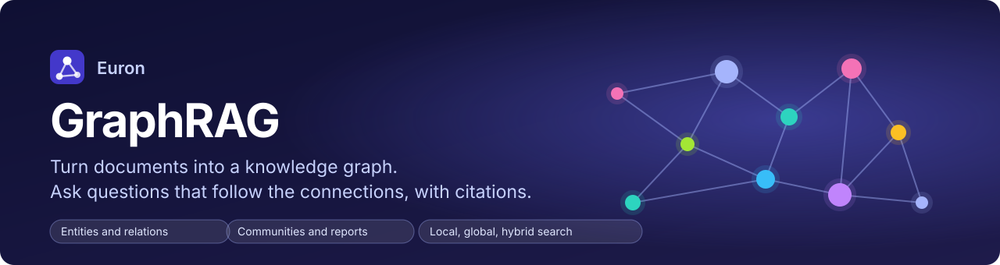
</p>

<p align="center">
  
  <a href="LICENSE"></a>
  
  
  
  
  
  
  
</p>

<p align="center">
  <a href="https://github.com/euron-sde-team/euron-graph-rag/stargazers"></a>
  <a href="https://github.com/euron-sde-team/euron-graph-rag/fork"></a>
  <a href="https://github.com/euron-sde-team/euron-graph-rag/watchers"></a>
  <br>
  <a href="https://github.com/euron-sde-team/euron-graph-rag/issues"></a>
  <a href="https://github.com/euron-sde-team/euron-graph-rag/pulls"></a>
  <a href="https://github.com/euron-sde-team/euron-graph-rag/commits/main"></a>
  
  <br>
  <a href="#built-by-the-team-behind-euron"></a>
</p>

<p align="center">
  <b><a href="#-quickstart">Quickstart</a></b> |
  <b><a href="#️-architecture">Architecture</a></b> |
  <b><a href="#-explore-the-repository">Explore the repo</a></b> |
  <b><a href="docs/api/openapi.json">API reference</a></b> |
  <b><a href="#️-deploy-to-aws">Deploy</a></b> |
  <b><a href="docs/architecture/security.md">Security</a></b> |
  <b><a href="#-documentation">Docs</a></b>
</p>

**Euron GraphRAG** is an open-source, MIT-licensed tool that turns documents into a knowledge
graph and answers questions over it, part of the open-source initiative of **ENGAGESPHERE
TECHNOLOGY PRIVATE LIMITED**. Upload PDF, Word, Markdown, HTML, text, CSV or web pages. GraphRAG
splits them into passages, extracts the entities and relations in them, merges the duplicates,
finds the communities the graph falls into at several levels, writes a report for each, and then
answers questions three ways: **local** search follows an entity's neighbourhood, **global**
search reads the community reports, **hybrid** does both. Every answer cites passages you can
open, and the playground shows which nodes, edges and communities were used.

It is for the person who has to make sense of a corpus (analyst notes, a wiki, contracts, tickets,
research) and needs more than "the top five similar passages": who is connected to whom, what the
main themes are, and where each claim came from.

- **A graph you can audit.** Every mention and every relation points at the passage that
  produced it. Counts and weights are derived from those rows, so reprocessing or deleting a
  document changes exactly what it supported.
- **Duplicates resolved, explainably.** "Helios", "Helios Robotics" and "Helios Robotics Inc"
  become one entity through alias, spelling, containment and acronym rules, previewed before a
  build merges them and fixable by hand.
- **Communities with reports.** Louvain with a connectivity guarantee and a hierarchy; each
  community has a title, a summary and findings that cite their passages.
- **Three ways to ask, one place to inspect.** Local, global and hybrid search return the answer,
  every numbered source (cited or merely retrieved), the subgraph used and a per-step trace.
- **An explorer built for it.** An interactive force layout with type, text and community
  filters, neighbourhood focus and an entity panel with its sources.

The whole stack runs on a laptop with no API key and no cloud account: a deterministic extractor,
embedder, report writer and answer composer, an AWS emulator, and the same Terraform that deploys
to AWS. OpenAI-compatible and Ollama adapters sit behind the same interfaces when you want a
language model.

<p align="center">
  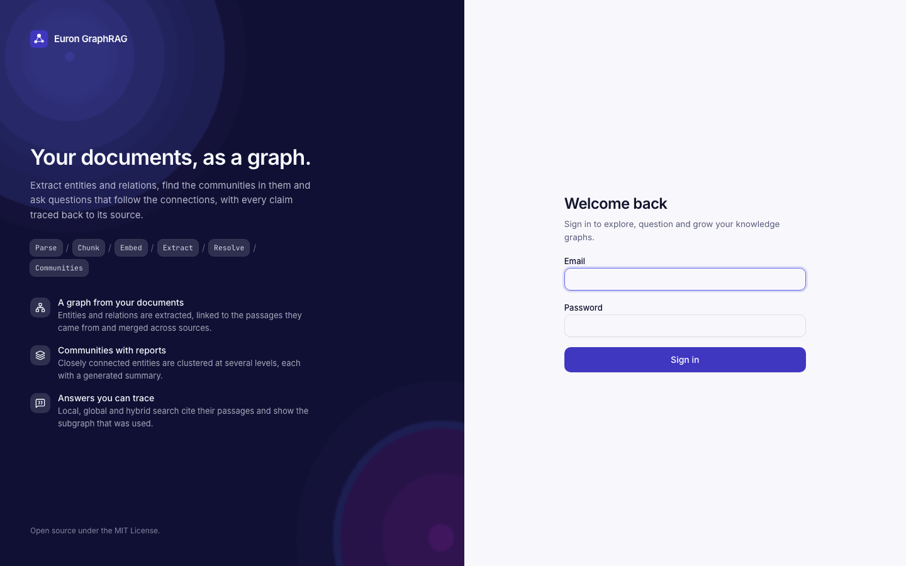
</p>

> [!NOTE]
> Everything in the tour ran for real: Docker Compose on a laptop, S3, SQS, KMS and Secrets
> Manager emulated locally and provisioned by the same Terraform modules that build production,
> the demo notes parsed, embedded, mined and clustered by the worker, and every answer produced
> by the search service. `make up && make demo` reproduces it. The offline extractor is a
> rule-based baseline: configure a model for higher recall (see [FAQ](#-faq)).

<h3 align="center">Built by the team behind Euron</h3>

<p align="center">Euron GraphRAG comes from the people who build these platforms. If you like how this repository is built, come and see what we build with it.</p>

<p align="center">
  <a href="https://euron.one"><picture><source media="(prefers-color-scheme: dark)" srcset="docs/assets/brand/euron-dark.svg"></picture></a>
  <a href="https://euronsystems.com"><picture><source media="(prefers-color-scheme: dark)" srcset="docs/assets/brand/euron-systems-dark.svg"></picture></a>
  <a href="https://alphaeuron.com"><picture><source media="(prefers-color-scheme: dark)" srcset="docs/assets/brand/alpha-euron-dark.svg"></picture></a>
</p>

<p align="center">
  <a href="https://www.instagram.com/euron_official"></a>
  <a href="https://www.linkedin.com/company/euronone/posts/"></a>
  <a href="https://x.com/euron712"></a>
  <a href="https://www.youtube.com/@Euron-official"></a>
  <a href="https://whatsapp.com/channel/0029VaeeJwq9RZAfPW9P2l07"></a>
</p>

---

## 📚 Table of contents

- [Why Euron GraphRAG](#-why-euron-graphrag)
- [At a glance](#-at-a-glance)
- [Screenshots](#️-screenshots)
- [Features](#-features)
- [Architecture](#️-architecture)
- [Tech stack](#-tech-stack)
- [Prerequisites](#-prerequisites)
- [Quickstart](#-quickstart)
- [Explore the repository](#-explore-the-repository)
- [API](#-api)
- [Configuration](#️-configuration)
- [Deploy to AWS](#️-deploy-to-aws)
- [Security model](#-security-model)
- [Testing](#-testing)
- [Documentation](#-documentation)
- [Roadmap](#️-roadmap)
- [FAQ](#-faq)
- [Contributing, security and license](#-contributing-security-and-license)

---

## 💡 Why Euron GraphRAG

Plain vector retrieval answers "what passages look like this question". It struggles with the
questions that matter most in a real corpus: how are these two companies connected through a
third, what do all these documents say about batteries, who is behind this product. The answers
are spread across documents and live in the relationships, not in any one passage.

A knowledge graph keeps those relationships. GraphRAG builds one from your documents and uses it
two ways: to walk outward from the things a question names (local search), and to summarize
clusters of related things so a question about the whole corpus can be answered from a handful of
reports instead of every passage (global search). What it adds over a research prototype is the
work around it:

- **Provenance everywhere.** A graph nobody can check is a rumour mill. Every edge carries the
  sentence that stated it; every answer carries numbered sources; a finding in a community report
  links to its passages.
- **Idempotent, incremental pipeline.** Re-running a document replaces its contribution; deleting
  it removes what only it supported; a batch of uploads is built once.
- **Offline first.** You can evaluate the whole product, run its tests and take its screenshots
  without a model, a key or a network. Models are an upgrade, not a prerequisite.
- **Operable.** Queue with dead-letter and reaper, graceful shutdown, probes, metrics,
  structured logs, roles, audit trail, Terraform for AWS.

## 📊 At a glance

| | |
| --- | --- |
| Input | PDF, Word, Markdown, HTML, text, CSV, web pages |
| Graph | Entities (8 types), typed relations, mentions and evidence, in PostgreSQL |
| Resolution | Alias, fuzzy spelling, containment, acronym; preview and manual merge |
| Communities | Louvain, connected, hierarchical (up to 4 levels), reports with cited findings |
| Search | Local, global, hybrid; citations; subgraph and trace; answer cache |
| Providers | Local deterministic (default), OpenAI-compatible, Ollama |
| Vectors | pgvector HNSW, widths 384, 768, 1024, 1536 |
| Tenancy | Projects, owner, editor and viewer roles, project-bound API keys |
| Runs on | Docker Compose with an AWS emulator, or AWS (ECS, RDS, ElastiCache, S3, SQS) |
| Tests | {{UNIT_PY}} Python unit, {{UNIT_WEB}} web unit, {{INTEGRATION}} integration, {{E2E}} browser |

## 🖼️ Screenshots

| | |
| --- | --- |
| 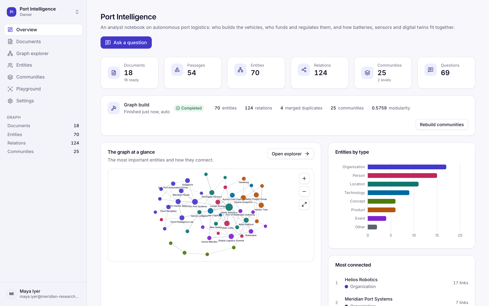 | 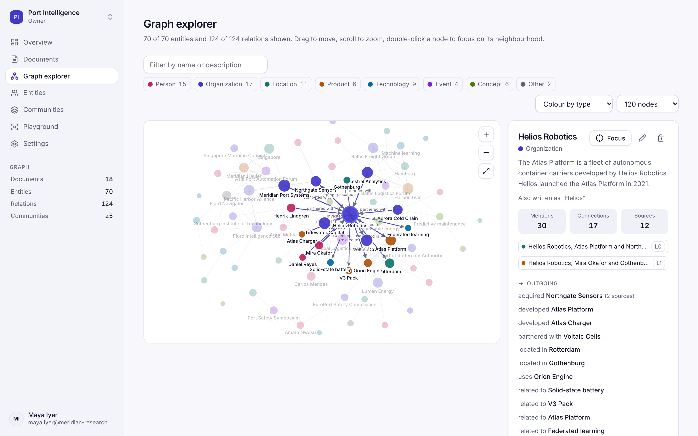 |
| **Overview**: counters, the latest build, the graph at a glance, types and traffic | **Graph explorer**: filters, an entity with its relations and sources |
| 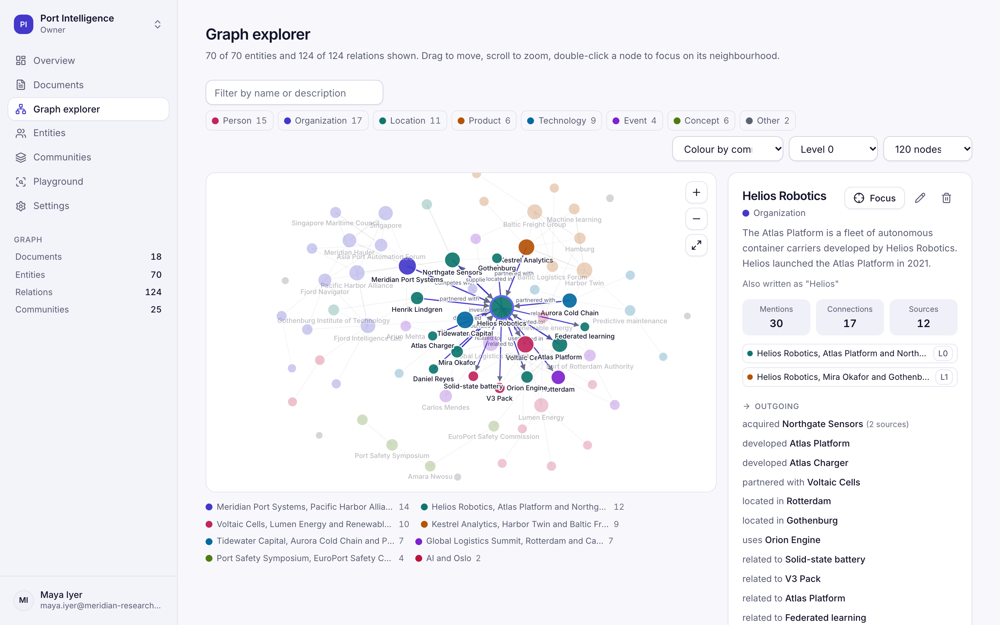 | 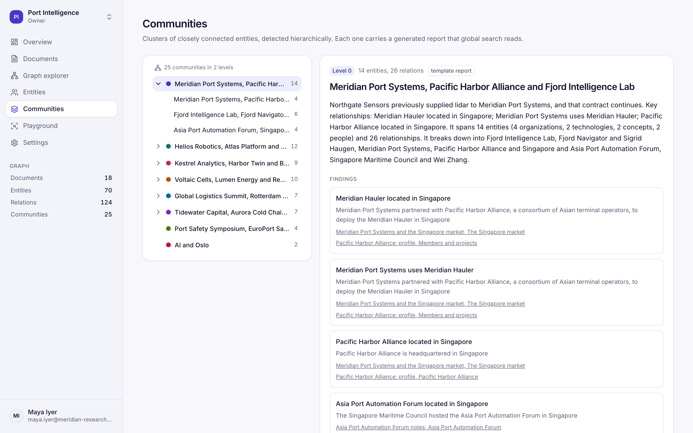 |
| **Colour by community** | **Communities**: hierarchy, report and cited findings |
| 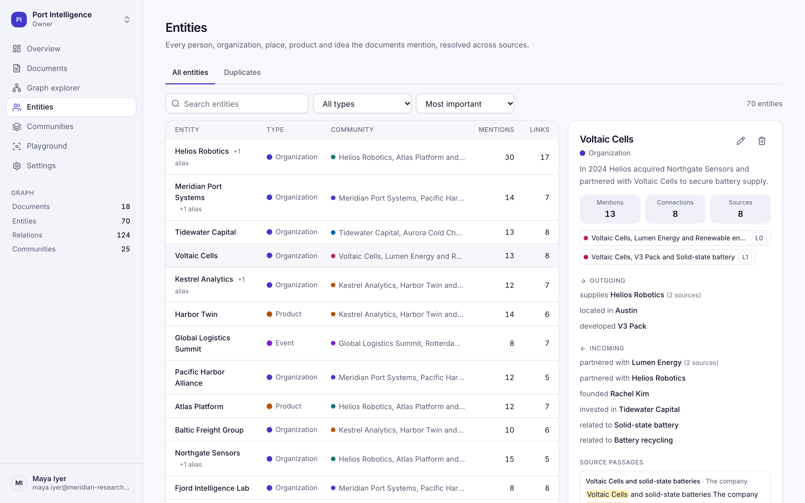 | 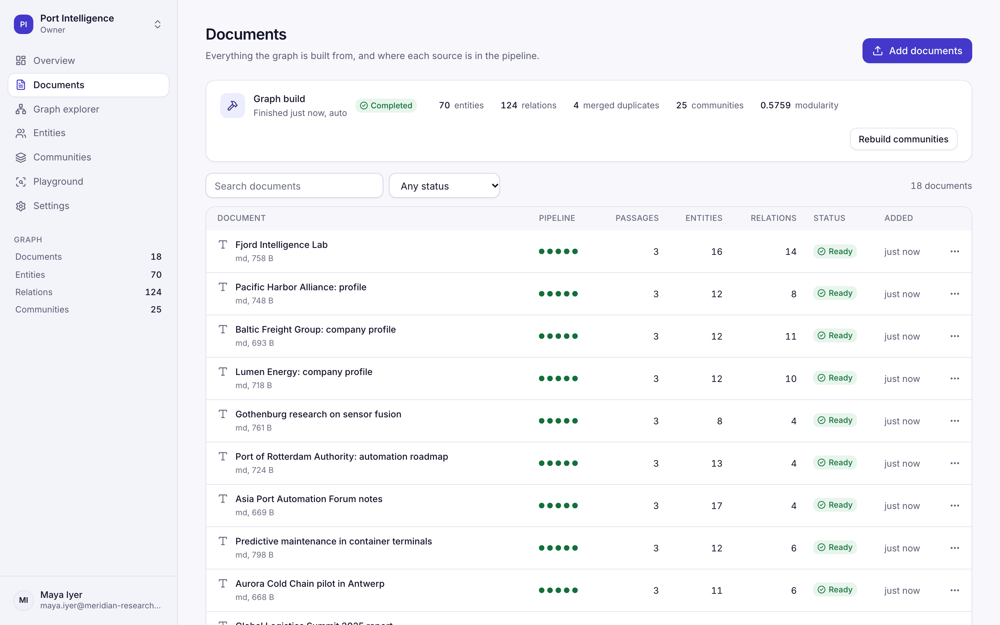 |
| **Entities**: search, filters, duplicates and details | **Documents**: pipeline stage per document and the build |
| 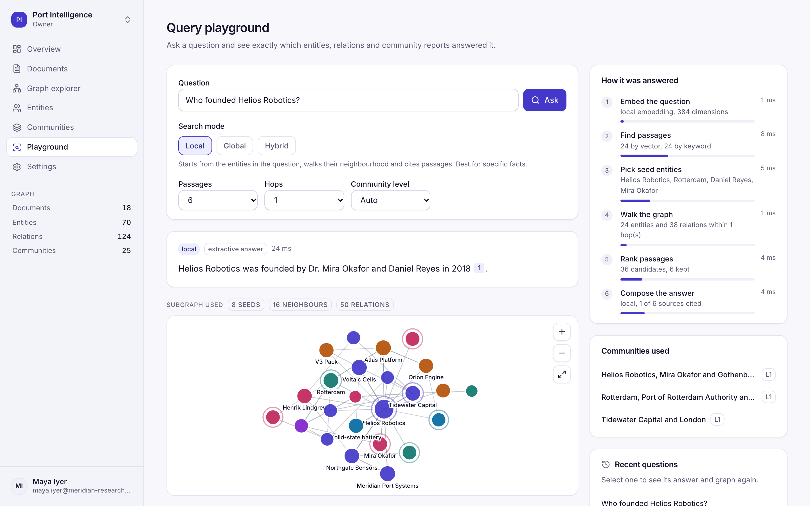 | 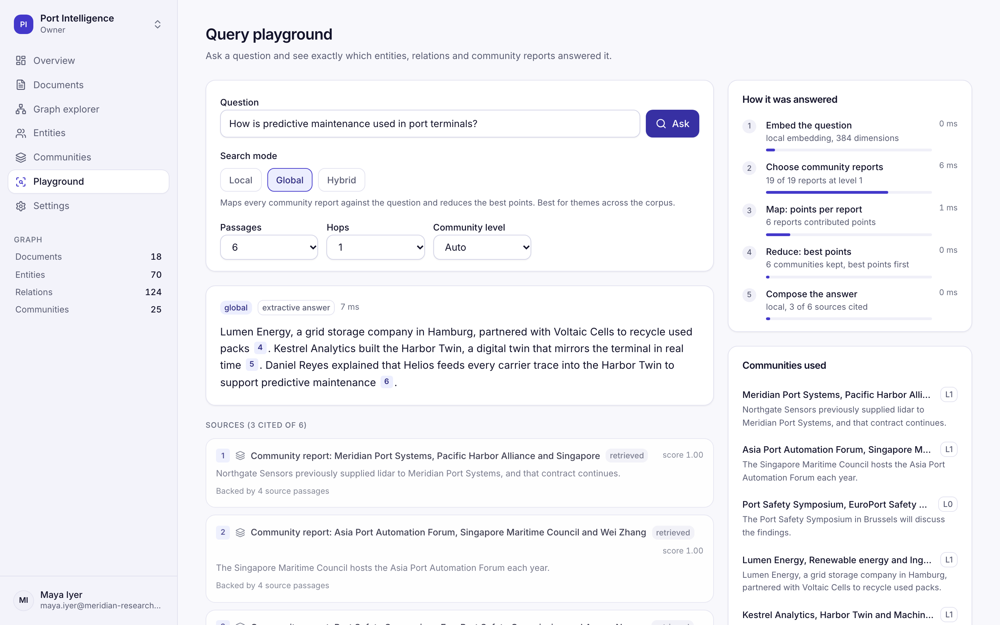 |
| **Local search**: cited answer, subgraph used, trace | **Global search**: map and reduce over community reports |
| 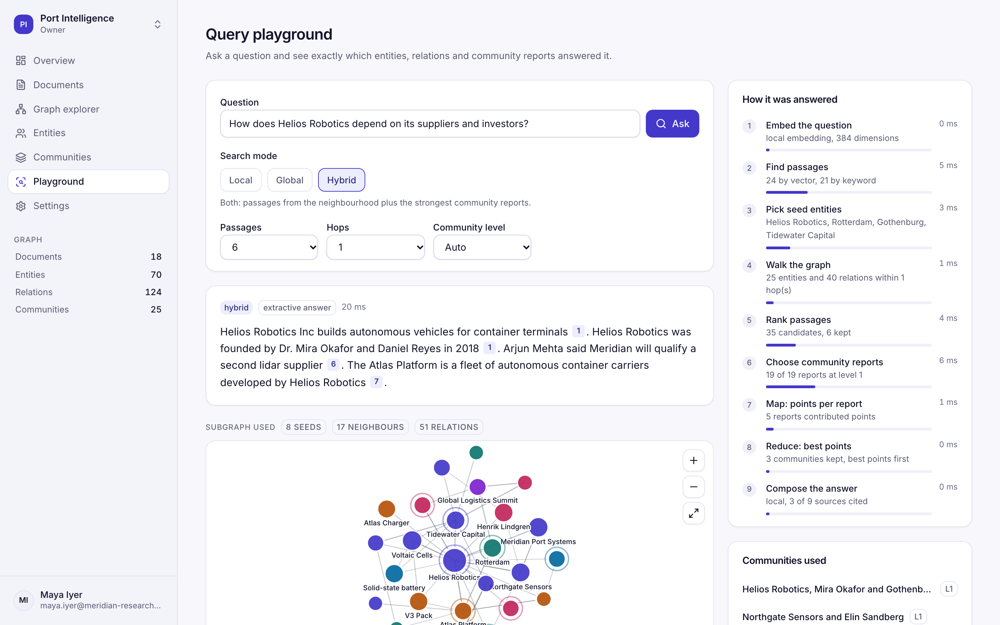 | 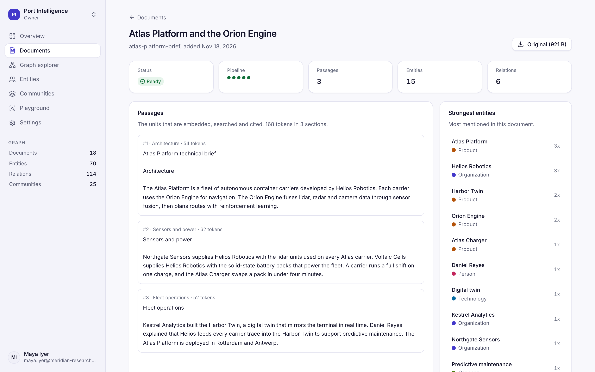 |
| **Hybrid search** | **A document**: passages and strongest entities |

## ✨ Features

- **Ingestion**: files, pasted text and URLs (SSRF-guarded); sniffed, size-limited, parsed with
  page caps; a document shows queued, parse, embed, extract, graph.
- **Extraction**: rule-based offline extractor (names, concept terms, verb patterns with type
  constraints, passive voice, shared subjects) or a model extractor with lenient JSON parsing and
  per-chunk fallback.
- **Resolution**: alias index so a merged name is recognised later; duplicate preview; manual
  merge, rename (old name kept as alias), retype and delete.
- **Communities**: seeded Louvain with connectivity split, hierarchy to four levels, template or
  model reports written bottom-up, replaced atomically.
- **Search**: seeds from names, embeddings and best passages; multi-hop expansion with decay;
  four-signal passage ranking; map-reduce over reports; extractive or model answers; citations
  validated; answer cache keyed by graph version.
- **Explorer**: SVG force layout computed up front (stable, reproducible), drag, pan, zoom,
  keyboard access, labels by importance, neighbourhood focus, type and text filters.
- **Operations**: SQS with dead-letter, reaper, SIGTERM hand-back, Prometheus metrics, JSON logs,
  probes, per-project advisory locks for graph writers.
- **Security**: Argon2id, session revocation, hashed project-bound API keys, CSRF origin checks,
  rate limits, per-project cache keys, audit trail, production config check.
- **Infrastructure**: Terraform modules and `local-floci`, `aws-dev`, `aws-prod` environments;
  `make aws-deploy`.

## 🏗️ Architecture

<p align="center">
  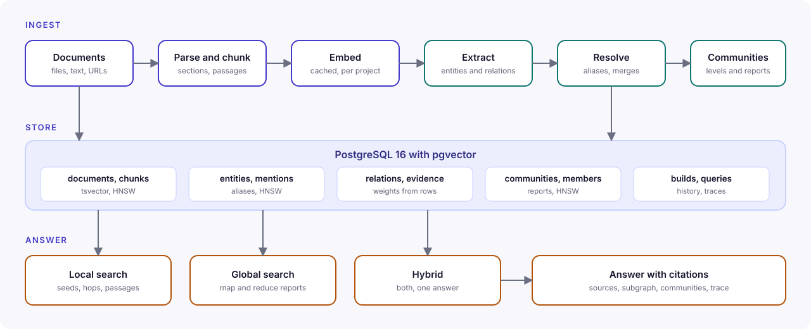
</p>

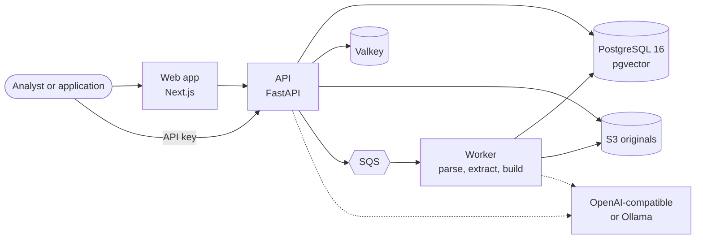

Three job kinds share one queue: `parse` (parse, clean, chunk, embed), `extract` (entities,
relations, mentions, evidence, derived counts) and `build` (resolve duplicates, detect
communities, write reports). The design is in [HLD](docs/architecture/HLD.md) and
[LLD](docs/architecture/LLD.md); the tables in [data-model](docs/architecture/data-model.md).

## 🧰 Tech stack

| Layer | Choice |
| --- | --- |
| API | Python 3.12, FastAPI, Pydantic v2, SQLAlchemy 2 (async, asyncpg), Alembic, redis-py, httpx, structlog, orjson, prometheus-client, typer |
| Data | PostgreSQL 16 with pgvector, Valkey 8, S3, SQS, KMS (Floci locally) |
| Web | Next.js 16 (App Router, standalone), React 19, TypeScript strict, Tailwind CSS 4, TanStack Query, d3-force, Recharts, Radix, Sonner |
| Tooling | uv, ruff, mypy strict, pytest, Vitest, ESLint, Prettier, Playwright, axe |
| Infra | Terraform, ECS Fargate, RDS, ElastiCache, ALB, CloudWatch, tflint, checkov |

## 📋 Prerequisites

Docker with Compose v2 (Docker Desktop or Colima), `make`, about 4 GB of free memory. For
development outside Docker: Python 3.12 with [uv](https://docs.astral.sh/uv/), Node 22 and pnpm 9.

## 🚀 Quickstart

```bash
make up      # build and start everything on emulated AWS
make demo    # accounts, a project, eighteen research notes, the graph, two weeks of questions
```

Open http://localhost:3200 and sign in with a demo account (`make demo` prints the password):

| Account | Role |
| --- | --- |
| `maya.iyer@meridian-research.example` | owner |
| `lucas.moreau@meridian-research.example` | editor |
| `hana.takeda@meridian-research.example` | viewer |

Ask a question from the shell with the API key `make demo` prints:

```bash
curl -s http://localhost:8200/api/v1/projects/port-intelligence/query \
  -H "authorization: Bearer grk_..." -H "content-type: application/json" \
  -d '{"question": "Who founded Helios Robotics?", "mode": "local"}'
```

`make down` stops the stack and deletes its volumes. [The quickstart guide](docs/guides/quickstart-local.md)
and the [walkthrough](docs/guides/walkthrough.md) go further.

| Port | Service |
| --- | --- |
| 3200 | Web app |
| 8200 | API (`/docs`) |
| 5460 | PostgreSQL |
| 6420 | Valkey |
| 4620 | Floci (AWS emulator) |

## 🧭 Explore the repository

```text
euron-graph-rag/
├── apps/
│   ├── api/                      FastAPI service, worker and CLI (package graphrag)
│   │   ├── src/graphrag/
│   │   │   ├── api/              routes and dependencies
│   │   │   ├── services/         business rules: ingestion, extraction, builds, graph, search
│   │   │   ├── repositories/     the only database access
│   │   │   ├── graph/            extraction, resolution, communities, reports, answer composition
│   │   │   ├── ai/               embeddings, chat clients, tokenizer
│   │   │   ├── ingestion/        parsers, cleaning, chunking
│   │   │   ├── integrations/     storage, queue, URL fetcher, AWS
│   │   │   ├── models/ schemas/  tables and API models
│   │   │   ├── migrations/       Alembic
│   │   │   └── demo/             the demo corpus and seeder
│   │   └── tests/{unit,integration}
│   └── web/                      Next.js dashboard
├── infra/{terraform,docker}      modules, three environments, images
├── deploy/compose/               base stack, Floci overlay, AWS overlay
├── e2e/                          Playwright: tests, QA crawl, screenshots
├── docs/                         architecture, ADRs, guides, API, assets
└── scripts/                      env, sanitization, test dependencies, AWS deploy
```

## 🔌 API

REST under `/api/v1`, documented in [`docs/api/openapi.json`](docs/api/openapi.json) and served at
`/docs`. Errors are `{"error": {"code", "message", "request_id", "details?"}}`.

| Group | Examples |
| --- | --- |
| documents | `POST /projects/{p}/documents`, `POST .../documents/import`, `GET .../documents/{id}/chunks` |
| graph | `GET .../graph/entities`, `GET .../graph/explore`, `GET .../graph/duplicates`, `POST .../graph/merge` |
| communities | `GET .../communities`, `GET .../communities/tree`, `GET .../communities/{id}` |
| builds | `POST .../builds`, `GET .../builds` |
| search | `POST .../query` (`local`, `global`, `hybrid`), `GET .../queries` |

See the [API guide](docs/api/README.md).

## ⚙️ Configuration

Environment variables validated at start; production refuses unsafe settings. Per-project graph
options (entity types, chunk size, hierarchy depth, resolution, automatic builds) are under
Settings. Reference: [configuration guide](docs/guides/configuration.md).

```bash
GRAPHRAG_LLM_PROVIDER=ollama          # local (default), openai or ollama
GRAPHRAG_LLM_MODEL=llama3.2
GRAPHRAG_EMBEDDING_PROVIDER=ollama
GRAPHRAG_EMBEDDING_MODEL=nomic-embed-text
GRAPHRAG_EMBEDDING_DIM=768
```

## ☁️ Deploy to AWS

```bash
cp infra/terraform/envs/aws-dev/terraform.tfvars.example infra/terraform/envs/aws-dev/terraform.tfvars
make aws-deploy ENV=aws-dev
```

Registries, images, infrastructure and rollout in one command: VPC, RDS with pgvector, ElastiCache,
S3 with KMS, SQS with a dead-letter queue, ECS services for API, worker and web, an ALB with HTTPS,
alarms. See [deploy-aws](docs/guides/deploy-aws.md) and [operations](docs/guides/operations.md).

## 🔐 Security model

Argon2id passwords with a timing-safe unknown-user path; JWT sessions with a revocation counter;
hashed, project-bound, expirable API keys; CSRF origin checks; per-principal rate limits; SSRF-safe
URL fetching; upload sniffing and size caps; per-project cache keys; audit trail; a production
configuration check that reports every problem at once. Details in
[security](docs/architecture/security.md) and the [STRIDE threat model](docs/architecture/threat-model.md);
report vulnerabilities as described in [SECURITY.md](SECURITY.md).

## 🧪 Testing

| Suite | Count | Command |
| --- | --- | --- |
| API unit (pytest) | {{UNIT_PY}} | `make test` |
| Web unit (Vitest) | {{UNIT_WEB}} | `make test` |
| API integration (PostgreSQL, Valkey, Floci) | {{INTEGRATION}} | `make test-integration` |
| Browser end to end (Playwright) | {{E2E}} | `make e2e` |
| QA crawl (desktop and mobile, axe) | {{QA}} | `make qa` |

`make lint typecheck` runs ruff, mypy (strict), ESLint, Prettier and tsc; `make tf-fmt tf-validate
tf-lint tf-security` covers the Terraform. [Testing guide](docs/guides/testing.md).

## 📖 Documentation

- Architecture: [HLD](docs/architecture/HLD.md), [LLD](docs/architecture/LLD.md),
  [data model](docs/architecture/data-model.md), [security](docs/architecture/security.md),
  [threat model](docs/architecture/threat-model.md), [ADRs](docs/architecture/adr/README.md)
- Guides: [quickstart](docs/guides/quickstart-local.md), [configuration](docs/guides/configuration.md),
  [deploy to AWS](docs/guides/deploy-aws.md), [operations](docs/guides/operations.md),
  [testing](docs/guides/testing.md), [troubleshooting](docs/guides/troubleshooting.md),
  [walkthrough](docs/guides/walkthrough.md)
- [API reference](docs/api/README.md), [CHANGELOG](CHANGELOG.md)

## 🗺️ Roadmap

- Embedding-based entity resolution as an opt-in rule next to the deterministic ones
- Native Leiden behind the existing community function for very large graphs
- Streaming answers in the playground
- Claim extraction and temporal facts on relations
- Per-document access control inside a project
- A Python client package

## ❓ FAQ

**Do I need a language model?** No. The default providers are deterministic and offline. The rule
extractor finds capitalized names and a list of concept terms and links them through verb
patterns; the answer composer quotes the best sentences of the sources. A model improves recall
and lets answers paraphrase; set `GRAPHRAG_LLM_PROVIDER`.

**Why Louvain and not Leiden?** Louvain needs no native dependencies. A connectivity split gives
the guarantee Leiden's refinement exists for. See [ADR 0002](docs/architecture/adr/0002-louvain-with-a-hierarchy-for-communities.md).

**Why PostgreSQL for a graph?** One system to run, transactions across graph, text and vectors,
and indexed neighbourhood walks that are fast at the size of one project. See
[ADR 0001](docs/architecture/adr/0001-postgres-and-pgvector-as-the-graph-store.md).

**How are duplicates merged, and can I undo one?** By four deterministic rules (alias, spelling,
containment, acronym), shown before they apply. A merge keeps the old names as aliases; there is
no undo, but reprocessing the documents recreates the entities.

**Can I change the embedding model later?** Yes, but vectors of another width are ignored until
documents are processed again. See [configuration](docs/guides/configuration.md).

**Where does my data go?** Nowhere with the local providers. With a hosted provider, passages are
sent to it for extraction, reports and answers.

**Can I run it without Docker?** The API and web app run with `uv` and `pnpm`, but they need
PostgreSQL with pgvector, Valkey and an S3 and SQS endpoint (or `STORAGE_BACKEND=local` and
`QUEUE_BACKEND=inline`).

## 🤝 Contributing, security and license

Read [CONTRIBUTING.md](CONTRIBUTING.md) and the [Code of Conduct](CODE_OF_CONDUCT.md). Report
vulnerabilities privately as described in [SECURITY.md](SECURITY.md). Released under the
[MIT License](LICENSE). Copyright (c) 2026 ENGAGESPHERE TECHNOLOGY PRIVATE LIMITED and the
GraphRAG contributors.
