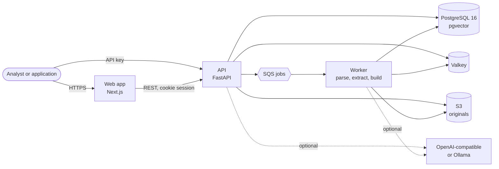
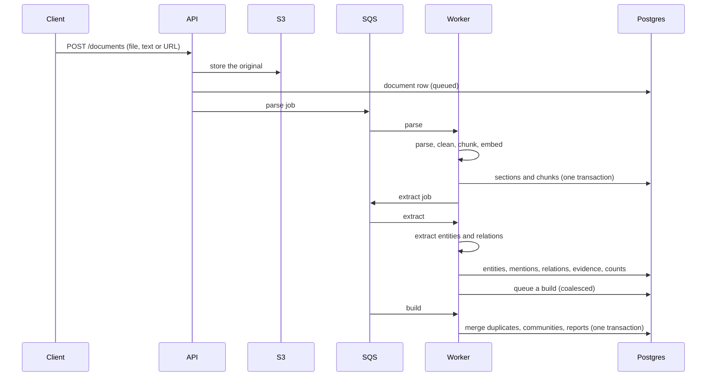

# High-Level Design

Euron GraphRAG turns a pile of documents into a knowledge graph and answers questions over it
with citations. This document explains what the product is, how its parts fit together and
why they are shaped the way they are. [LLD.md](LLD.md) goes into the algorithms,
[data-model.md](data-model.md) into the tables.

## Product

A team uploads documents (PDF, Word, Markdown, HTML, text, CSV, web pages). GraphRAG:

1. **parses and chunks** them into passages and embeds every passage;
2. **extracts entities and relations** from the passages, remembering the passage each fact
   came from;
3. **resolves duplicates** ("Helios", "Helios Robotics Inc" and "Helios Robotics" become one
   entity) and **detects communities**, clusters of closely connected entities, at several
   levels;
4. **writes a report** for every community (a title, a summary and cited findings);
5. **answers questions** in three ways, always with citations:
   - **local search** starts at the entities a question is about, walks their neighbourhood
     and cites the passages behind them;
   - **global search** maps every community report against the question and reduces the best
     points into one answer (questions about the whole corpus);
   - **hybrid** does both.

The web app has a graph explorer (force layout, filters, entity detail with sources), a
document and ingestion view, a community hierarchy, entity management with duplicate review
and a query playground that shows which nodes, edges and communities were used.

Everything runs locally with no cloud account and no API key. A deterministic local provider
does extraction, embedding, report writing and answer composition, so tests, demos and
screenshots reproduce exactly. OpenAI-compatible and Ollama adapters sit behind the same
interfaces for deployments that want a language model.

## Goals and non-goals

Goals:

- A graph that is **auditable**: every entity mention and relation points at the passage that
  produced it, and every answer cites passages or community reports that resolve to passages.
- **Offline first**: the full pipeline and every test run without a model or a network.
- **Incremental**: adding or deleting one document changes only what that document supports;
  counts, weights and degrees are derived, never incremented.
- **Multi-tenant**: a project is one graph; roles (owner, editor, viewer) and project-bound
  API keys gate every route.
- **Operable**: queue with dead-letter, reaper, graceful shutdown, probes, metrics, structured
  logs, Terraform for AWS.

Non-goals: a chat application, a graph database server (the graph lives in PostgreSQL), a
general ontology editor, streaming answers (the playground returns the whole answer and its
trace in one response).

## Domain concepts

| Concept | Meaning |
| --- | --- |
| Project | One knowledge graph and its tenancy boundary: documents, chunks, entities, relations, communities, queries, members, keys. |
| Document | A source: uploaded file, pasted text or fetched URL, with a pipeline stage and status. |
| Chunk | A passage of a document; the unit of embedding, keyword search and citation. |
| Entity | A node: person, organization, location, product, technology, event, concept or other. Unique per (project, normalized name). |
| Mention | An entity occurring in a chunk (with the surface form and a count). |
| Relation | A directed, typed edge between two entities, with a weight that grows with evidence. |
| Evidence | The chunk (and quote) that supports a relation. |
| Community | A cluster of entities at one level of a hierarchy, with a generated report. |
| Build | One run of duplicate resolution, community detection and report writing. |
| Query | A question, its mode and everything that answered it. |

## System context

## Containers

| Container | Responsibility |
| --- | --- |
| `web` | Next.js standalone server. One image for every environment: the API URL and product name are read at runtime from `/env.js`. |
| `api` | FastAPI: authentication, projects, documents, graph reads and edits, search, overview, builds. Applies migrations on boot when asked. |
| `worker` | Long-polls SQS and runs three job kinds: `parse`, `extract`, `build`. Same image as the API. |
| `postgres` | System of record, including vectors (pgvector, HNSW) and full-text search. |
| `valkey` | Embedding and query caches, rate limits, session revocation, the reaper lease. |
| `floci` | AWS emulator for local runs (S3, SQS, KMS, Secrets Manager), provisioned by the same Terraform that builds AWS. |
| `terraform` | One-shot container that applies `infra/terraform/envs/local-floci` before the API and worker start. |

## Main flows

### 1. Ingest a document

Every step is idempotent. A duplicated message for finished work is dropped; a crashed
worker's message becomes visible again and the work restarts from the stored inputs.

### 2. Build communities

The build resolves duplicates (alias, fuzzy spelling, containment, acronym), runs Louvain on the
weighted graph, splits disconnected communities, partitions large communities again for the
next level, writes a report bottom-up (a parent is written from its children's reports) and
replaces all communities in one transaction, so readers see the old set or the new one.

### 3. Ask a question

Local: embed the question, find seed entities (names in the question, nearest entity
embeddings, entities in the best passages), expand a few hops, score passages on four signals
and answer from the best ones. Global: score every report of one level, map the relevant
ones to points, reduce the best points. Hybrid: both. The response carries the answer, every
numbered source (cited or merely retrieved), the nodes, edges and communities used and a
per-stage trace.

### 4. Edit the graph by hand

Entities can be renamed (the old name becomes an alias), retyped, merged and deleted.
Merging re-points mentions, relations and evidence onto the survivor, collapsing duplicates;
a rebuild is queued so communities follow.

## API surface

REST under `/api/v1`, documented in [`docs/api/openapi.json`](../api/openapi.json) and served at
`/docs`. Groups: `auth`, `projects` (members, activity), `documents` (import, upload, chunks,
reprocess), `graph` (entities, explore, duplicates, merge), `communities`, `builds`, `search`
(`query`, history), `overview`, `api-keys`, `system`. Errors are always
`{"error": {"code", "message", "request_id", "details?"}}`; every response carries
`X-Request-Id`.

## Deployment topology

Locally: Docker Compose (`make up`) with Floci standing in for AWS. On AWS: the Terraform
modules provision a VPC, RDS PostgreSQL (pgvector), ElastiCache, S3 with KMS, SQS with a
dead-letter queue, Secrets Manager, ECR, ECS Fargate services for the API, the worker and the
web app behind an ALB (and optionally CloudFront), and CloudWatch alarms. See
[deploy-aws](../guides/deploy-aws.md).

## Scalability

- API and worker scale horizontally; state is in Postgres, Valkey, S3 and SQS.
- Vector search uses partial HNSW indexes, one per supported embedding width; keyword search a
  GIN index; entity name search a trigram index.
- Graph reads are paginated everywhere; the explorer caps a view at 400 nodes.
- Builds read the whole graph of one project; at tens of thousands of entities the hierarchy
  step stays in memory and takes seconds. Builds of different projects run in parallel;
  builds of one project coalesce.

## Availability and failure modes

| Failure | Behaviour |
| --- | --- |
| Valkey down | Requests pass uncounted by rate limits and uncached; sign-in fails closed. |
| Model provider down | Extraction and reports retry through SQS (three receives, then the dead-letter queue); questions return a 502 with a clear message. |
| Worker killed | In-flight messages are handed back on SIGTERM; after a crash they reappear after the visibility timeout; the reaper restarts stuck rows. |
| Unparsable model reply | That chunk falls back to the rule extractor; a report falls back to the template. |
| Build fails | The previous communities stay in place; the build row records the error. |

## Security summary

Argon2id passwords, JWT sessions with a revocation counter, project-bound hashed API keys,
CSRF origin checks for cookie sessions, per-project cache keys, SSRF-safe URL fetching, size
limits, strict request bodies. See [security.md](security.md) and the
[threat model](threat-model.md).

## Observability

Prometheus metrics (`/metrics`, and the worker's own port): HTTP, documents parsed, chunks,
extractions, entities and relations written, merges by rule, builds, query stages, cache hits.
Structured JSON logs with request ids. `/livez` and `/readyz` probes.

## Key design decisions

See [adr/](adr/README.md): PostgreSQL and pgvector as the graph store, Louvain with a
hierarchy, a deterministic local provider, derived counts, entity resolution rules, Floci for
local AWS and one queue for three job kinds.
