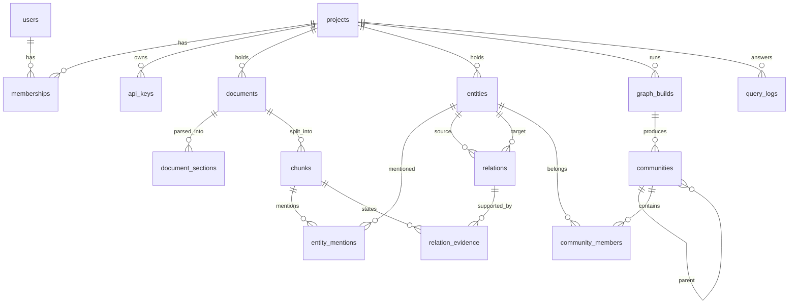

# Data model

PostgreSQL 16 with the `vector`, `citext` and `pg_trgm` extensions. One migration
(`apps/api/src/graphrag/migrations/versions/0001_initial_schema.py`) creates everything.
Identifiers are UUIDv7 (time ordered). Constraint and index names follow a fixed convention
(`ix_`, `uq_`, `fk_`, `ck_`). Every table below `projects` carries `project_id` or reaches it
through a cascading key, so deleting a project deletes its graph.

## Accounts and tenancy

| Table | Notes |
| --- | --- |
| `users` | `email` (citext, unique), Argon2id `password_hash`, `is_admin`, `session_version` (bumped to revoke every session), failed-login counter and lockout. |
| `projects` | `slug` unique, `settings` (JSONB, validated as `GraphSettings`), `graph_version` (bumped on every graph change; keys the query cache). |
| `memberships` | `(project_id, user_id)` primary key, `role` in owner, editor, viewer. |
| `api_keys` | HMAC-SHA256 of the secret only; `prefix` unique, `role` editor or viewer, `expires_at`, `revoked_at`, `last_used_at`. |
| `audit_events` | Who did what in a project: action, target, details, actor user or key. |

## Documents and passages

| Table | Notes |
| --- | --- |
| `documents` | `(project_id, external_id)` unique; `source_type` file, url or text; `status` queued, processing, ready, failed; `stage` queued, parsing, embedding, extracting, done; counts of sections, tokens, chunks, entities, relations; unique `(project_id, sha256)` for files and text, `(project_id, source_uri)` for URLs; a partial index of unfinished rows for the reaper. |
| `document_sections` | The parse result (blocks with heading levels), so re-chunking never parses again. |
| `chunks` | `text`, `heading`, `location`, character offsets, `token_count`, `embedding` (untyped `vector`) with `embedding_dim`, generated `tsv` for full-text search. HNSW partial indexes per width (384, 768, 1024, 1536), GIN on `tsv`. A check keeps `vector_dims(embedding) = embedding_dim`. |

## The graph

| Table | Notes |
| --- | --- |
| `entities` | `(project_id, key)` unique, where `key` is the normalized name; `name`, `type`, `description`, `aliases` (JSONB list of merged names), `mention_count`, `degree`, `importance` (weighted degree plus a mention bonus), `embedding`/`embedding_dim`. Indexes on `(project_id, type)`, `(project_id, importance DESC)`, trigram on `name`, HNSW partial per width. |
| `entity_mentions` | `(entity_id, chunk_id)` primary key, `document_id`, `surface`, `count`. |
| `relations` | `(source_id, target_id, predicate)` unique, `weight`, `evidence_count`, `description`; a check forbids self loops. |
| `relation_evidence` | `(relation_id, chunk_id)` primary key and the `quote` that stated the relation. |

`mention_count`, `evidence_count`, `weight`, `degree` and `importance` are derived from the
mention and evidence rows (`GraphRepository.recount`, `refresh_degrees`). Nothing increments
them in place, so reprocessing a document, deleting it or merging entities cannot double count.

## Communities and builds

| Table | Notes |
| --- | --- |
| `graph_builds` | `status` queued, running, completed, failed; `trigger` auto or manual; `params` and `stats` (JSONB); attempts; timestamps. Partial index of unfinished builds. |
| `communities` | `(build_id, level, ordinal)` unique; `parent_id` (self reference, cascade); `title`, `summary`, `findings` (JSONB: summary, explanation, chunk ids), `entity_count`, `relation_count`, `rank` (sum of member importance), `reporter`, `embedding`. A completed build replaces all of a project's communities in one transaction. |
| `community_members` | `(community_id, entity_id)`; an entity belongs to one community per level (isolated entities to none). |

## Questions

`query_logs`: `mode` (local, global, hybrid), `question`, `answer`, `answerer`, the whole
response in `result` (citations, nodes, edges, communities, steps), citation count, latency,
token counts and a cached flag. It feeds the playground history and the traffic charts.

## Integrity rules worth knowing

- Cascades run from `projects` down; deleting a `document` cascades to chunks, mentions and
  evidence, and the service then recounts and removes what nothing supports.
- Entity keys ignore case, accents, titles ("Dr."), possessives and trailing corporate
  suffixes ("Inc"), so "Dr. Mira Okafor" and "Mira Okafor's" are one entity.
- A relation cannot point from an entity to itself; merging that would create one deletes it.
- Vectors of another width are never compared: queries add `embedding_dim = <width>` as a SQL
  literal so the matching partial index is used.
